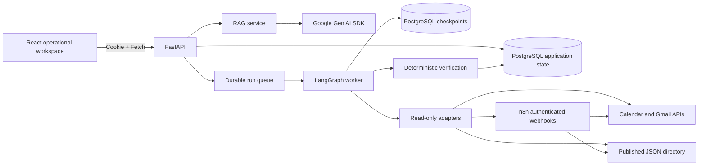
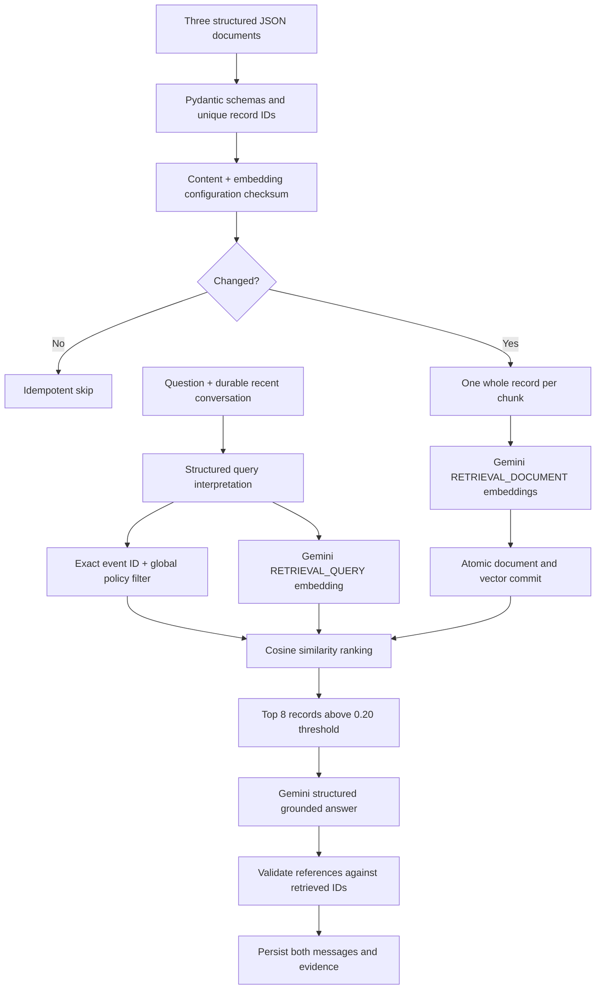
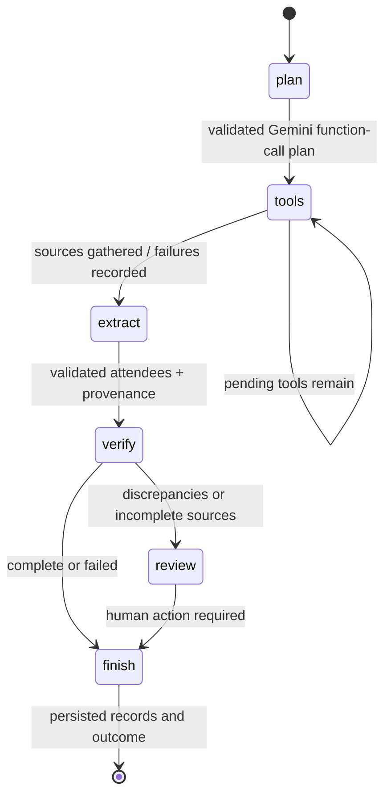
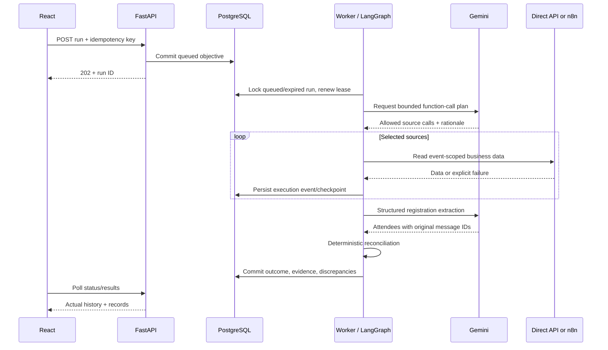
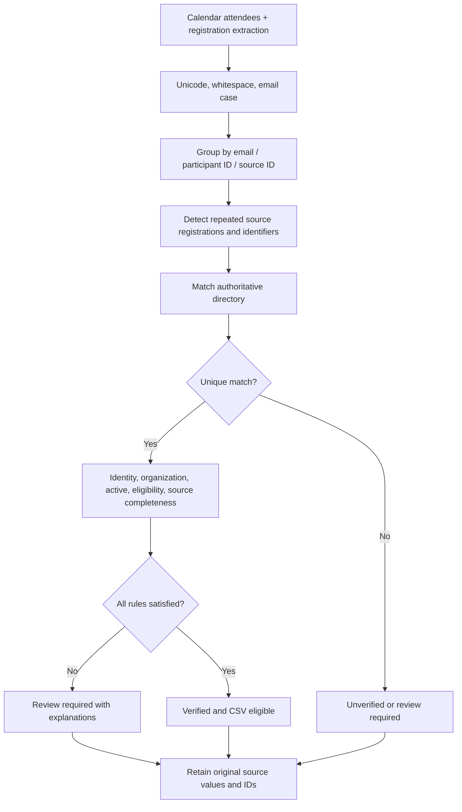

# System design

## Component architecture

The two integration transports are mutually selected by configuration. LangGraph never delegates verification or lifecycle ownership to n8n. API request threads do not execute long agent runs: run initiation commits a durable queued record, then the worker claims it.

## Ingestion and RAG

Structured records are short; whole-record chunks preserve field relationships and source identity. Vectors are persisted as PostgreSQL JSON arrays; exact cosine search is performed in the service over this small assessment corpus. This is genuine vector retrieval in live mode, not a token ranking replacement. Query interpretation may resolve conversational references, while explicit EVT identifiers override inferred IDs. Event-filtered queries retain global policies and directory entries eligible for that event. Retrieval limit/threshold are initial engineering choices requiring live evaluation.

The current corpus is 13 indexed records (3 events, 4 policies, 6 participants). No approximate vector index is needed at this size. `pgvector` is a scaling option, not a prerequisite for semantic embeddings. All vectors in an index use the same model and dimensions. Fixture vectors are deterministic test doubles and are labeled as such.

Answer contracts include `answer`, `supported` and `citations`; every cited ID must be in retrieved evidence. Supported answers must cite at least one record. Unsupported answers return no citations. Citation identity checks are deterministic; semantic entailment still requires evaluation and human inspection. The last eight persisted messages are supplied to generation, while the full history remains in PostgreSQL.

## Agent state graph

State includes run ID, objective, immutable event ID, plan, pending tools, collected source payloads, failures, extracted attendees, verification records and outcome. Gemini selects allowed read tools through actual function calls. The executor validates names, IDs, uniqueness and a maximum of three calls. `web` is mandatory. Missing Calendar/Gmail evidence prevents verified outcomes even if the model chooses a narrower plan. The graph records partial source failures, extracts surviving inputs, then applies deterministic rules.

Review is an explicit graph transition and a durable terminal review-required state. Staff can add a review note; the system deliberately does not let a note turn an unresolved record into verified output. Correct the source and start an idempotently identified new run. The graph's review state is not a suspended interactive LangGraph `interrupt()` requiring a later resume.

## Integration sequence

## Verification flow

## Database responsibilities

| Table | Durable information |
|---|---|
| sessions | Hashed random cookie tokens and expiry; login throttle |
| oauth_states | One-use state, session binding and expiry |
| credentials | Encrypted dedicated Google OAuth tokens |
| documents | Source checksum and ingestion model/version/time |
| chunks | Whole records, vectors, source metadata and event IDs |
| conversations / messages | Operator-owned history, answers and retrieval evidence |
| runs | Idempotent objectives, mode, lifecycle, lease and final workflow state |
| executions | Stage/tool timestamps, outcomes, errors, retries, human notes |
| verifications | Normalized rows, status, reasons and original evidence |
| LangGraph checkpoint tables | Resumable graph snapshots and pending work |

Run and conversation ownership are enforced by the API. A unique `(owner, idempotency_key)` prevents duplicated workflow requests. Result IDs derive from run ID and index, so replacing a finished result set is idempotent. Initialization is additive schema version 1; future schema changes require explicit migrations.

## API contracts

All operational endpoints require an authenticated HTTP-only cookie except login, health and OAuth callback (callback independently checks the bound session). Mutations require the exact allowed Origin header. Requests are Pydantic-validated; FastAPI publishes request schemas at `/docs` and `/openapi.json`.

| Method/path | Input | Output / behavior |
|---|---|---|
| GET `/api/health` | None | Database readiness, mode; 503 on DB failure |
| POST `/api/session` | username, password | Secure opaque session cookie; 401/429 on failure |
| GET/DELETE `/api/session` | Cookie | Current operator / revoke cookie token |
| GET `/api/status` | Cookie | Configuration truth, no secrets |
| GET `/api/documents` | Cookie | Ingestion metadata and checksums |
| POST `/api/documents/ingest` | Cookie + Origin | Idempotent validated embedding ingestion |
| GET `/api/conversations` | Cookie | Saved conversation IDs |
| GET `/api/conversations/{id}` | Cookie | Messages, evidence and retrieval details |
| POST `/api/rag/query` | question, optional conversation_id | Answer, support flag, citations, evidence, retrieval |
| POST `/api/runs` | objective, event_id, idempotency_key | 202 durable run; 409 key conflict |
| GET `/api/runs` | Cookie | Latest 100 persisted runs |
| GET `/api/runs/{id}` | Cookie | Run state and chronological execution events |
| GET `/api/runs/{id}/results` | Cookie | Verification records and provenance |
| POST `/api/runs/{id}/review` | note | Durable staff note; statuses unchanged |
| GET `/api/runs/{id}/export.csv` | Cookie | Verified-only CSV with formula neutralization |
| GET `/api/integrations/google/start` | Cookie | OAuth authorization redirect |
| GET `/api/integrations/google/callback` | code, state | Validated token exchange and UI redirect |
| DELETE `/api/integrations/google` | Cookie + Origin | Remove locally saved credentials |

Failure codes: 401 unauthenticated; 403 bad Origin; 404 inaccessible records; 409 idempotency/review conflict; 422 invalid input or unknown event; 429 bounded admission/throttle; 502 failed model/external contract; 503 unavailable configuration/service. UI surfaces actual API messages.

## Audit maintenance and limits

This documentation explains component responsibilities, interfaces and architectural decisions; it communicates design intent to implementation/reviewers rather than executing integrations. Validate claims against `backend/app/README.md`, the complete test suite and PostgreSQL verification scripts. The new `usage_counters` table stores atomic durable limits; `scripts/export_schema.py` reproduces the application DDL. The version-1 additive initializer is not a changed-column migration system. Read `docs/submission/compliance-matrix.md` and the deployment policy for current live/deployment blockers; diagrams and decisions cannot establish provider billing or live quality.
